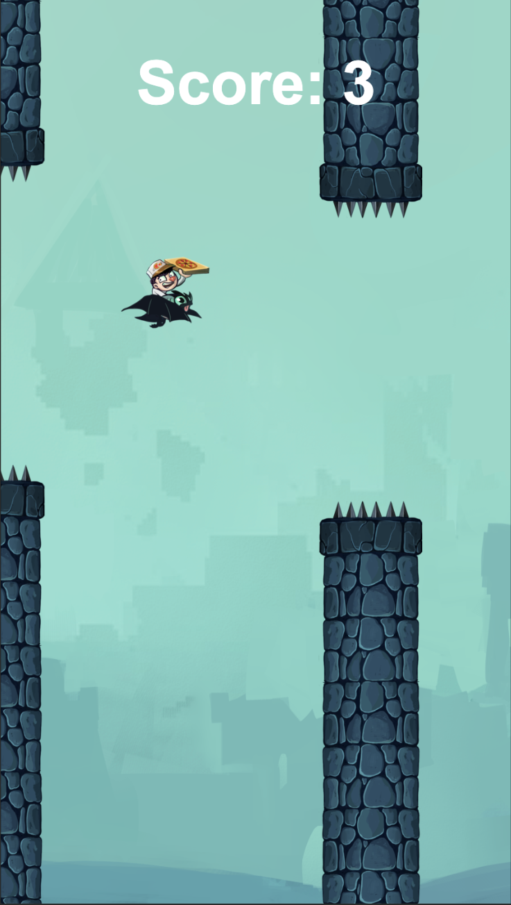

# Flappy Bat

Простая игра в жанре «flappy»: курьер на летучей мыши пролетает между башнями. Учебный проект на Cocos Creator.



## Как играть

- Клик или тап — взмах вверх.
- Пролетел между башнями — +1 очко.
- Задел башню или вылетел за экран — игра окончена. Можно начать заново или выйти в меню.

## Что есть в игре

- Главное меню и игровая сцена.
- Физика 2D: гравитация, импульс прыжка, столкновения.
- Случайная генерация препятствий.
- Счёт с анимацией.
- Экран проигрыша, рестарт без перезагрузки сцены.
- Музыка в меню и в игре, звуки прыжка и проигрыша.
- Тряска камеры при проигрыше.

## Запуск

1. Открой папку проекта в **Cocos Creator 3.8.8**.
2. Выбери стартовую сцену `MainMenu` и нажми ▶ в верхней панели.

## Сборка под веб

1. **Publish → X-Device → Web Mobile**.
2. Start scene: `MainMenu`, нажми **Build**, затем **Run**.

Готовая сборка лежит в `build/web-mobile`. Открывать её нужно через веб-сервер, а не двойным кликом по `index.html`, иначе браузер заблокирует загрузку файлов:

```bash
cd build/web-mobile && python3 -m http.server 8080
```

## Структура

```
assets/
  animations/  анимация полёта
  music/       музыка и звуки
  prefabs/     башни и сенсор очков
  scenes/      MainMenu, MainScene
  scripts/     GameManager, FailureWindow, MainMenu
  textures/    спрайты
```
